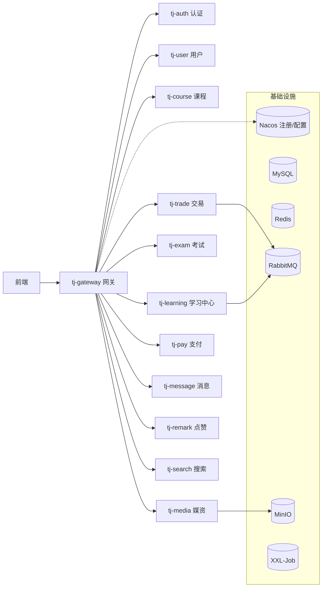

# 天机学堂 · 在线学习平台后端

基于 Spring Cloud 微服务架构的在线学习平台后端项目,包含课程、媒资、学习计划、积分、考试、交易支付、消息中心等微服务。个人学习项目,用于实践微服务架构与常用中间件。

## 技术栈

- **微服务**:Spring Cloud Gateway、Nacos、OpenFeign、Sentinel
- **框架**:Spring Boot、MyBatis-Plus
- **存储与中间件**:MySQL、Redis、RabbitMQ、MinIO、Elasticsearch
- **任务调度**:XXL-Job

## 架构

## 核心模块

- **tj-learning 学习中心**:学习计划制定与进度跟踪;积分体系(学习行为触发积分发放、积分排行榜、连续签到);互动问答
  - 积分结算通过 RabbitMQ 异步处理,避免阻塞主流程
  - 基于死信队列实现延迟消息,完成积分任务到期结算
  - 幂等设计防止积分重复发放
- **tj-gateway 网关**:统一路由、JWT 身份校验、Sentinel 限流与熔断降级
- **tj-trade / tj-pay 交易支付**:下单、支付回调、退款流程,延迟消息处理超时关单
- **tj-course / tj-media 课程与媒资**:课程管理与分类缓存,腾讯云 VOD 视频点播、断点续传
- **tj-exam 考试**:题库管理、试卷练习

## 启动说明

依赖环境:Nacos、MySQL、Redis、RabbitMQ、MinIO、XXL-Job(本地或 Docker 部署)

1. 启动上述基础中间件
2. 各服务通过 Nacos 获取配置与注册发现,按需启动服务
3. 各服务 `bootstrap.yml` 中云服务密钥已脱敏,需自行填入(腾讯云 VOD / 阿里云短信)
